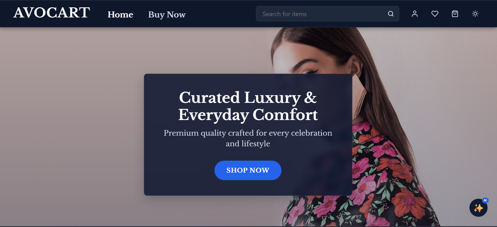
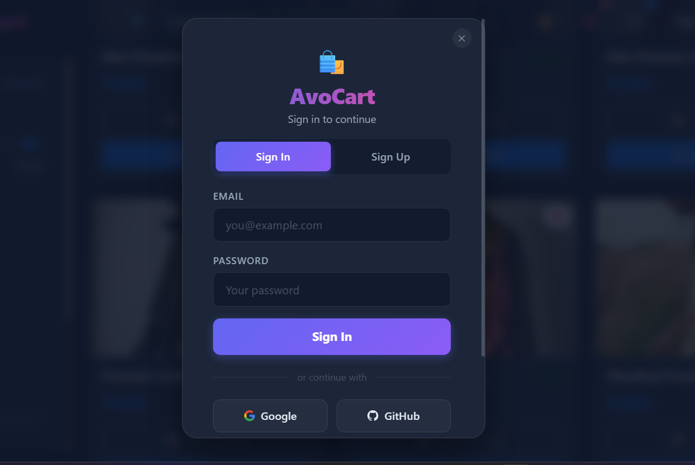

# AvoCart App

---

A full-stack e-commerce web application built with a React frontend and Node.js/Express + MongoDB backend supporting product discovery, multi-criteria filtering & sorting, cart & wishlist management, coupon discounts, address CRUD, checkout, OAuth/JWT authentication, and order history.

---

## Demo Link

[Live Demo](https://avo-cart-client.vercel.app/)

---

## Quick Start

```bash
git clone https://github.com/Sourabhpande532/AvoCartClient.git
cd AvoCartClient
npm install
npm start
```

---

## Technologies

- React JS (React 19, Context API, Custom Hooks)
- React Router v7
- Bootstrap 5 & Custom CSS Design Tokens (Light & Dark Theme)
- Node.js & Express.js
- MongoDB & Mongoose
- RESTful APIs
- Google / GitHub OAuth 2.0 & JWT Authentication

---

## Demo Video

Watch a walkthrough (5-7 minutes) of all major features of this app:<br>
[Drive Video Link](https://drive.google.com/file/d/1NNU6ChnTuG-kULwX14hQ2lhDyn_oo_RT/view)

---

## Features

**Home & Product Listing Page**

- Hero slideshow carousel, asymmetric Bento category grid, promotional sale banners, and hover-reveal lifestyle collection mosaic.
- Product listing page with combinable filters (`category` checkboxes, `rating` slider & radio options, `price` range slider) & sorting (`price low ↔ high`, `name A ↔ Z`) with a one-click `CLEAR` reset.

**Product Details**

- Product cards showing `image`, `title`, `price`, `discount`, `rating` pill, wishlist heart toggle, and quick actions (`Add to Cart` / `Add to Wishlist`).
- Detailed product page with quantity-reactive pricing, size selector, delivery trust badges, and related product recommendations.

**Cart & Wishlist**

- Cart and Wishlist pages to `add/remove` items, `update` `quantity`, apply seasonal/festive coupons, and seamlessly move items between Cart and Wishlist.

**User Profile & Checkout**

- Profile page displaying user details (`name`, `email`, `phone`, `address`), full address CRUD (`add`, `edit`, `delete`), and order history tracking.
- Checkout flow with address selection, itemized order breakdown, price summary, and `"Order Placed Successfully."` confirmation.

**Loading, Alerts & Search**

- Global search in the navbar, spinner loading states, and toast notifications for all user actions.
- Fully responsive UI across mobile, tablet, and desktop viewports.

---

## Reference

## 

## 

---

## APIs Reference

### GET /api/products

Retrieve all products with populated category details.

Sample Response:

```json
[
  { "_id": "...", "title": "...", "price": 1999, "category": { "_id": "...", "name": "Men" }, "rating": 4.5, "countInStock": 15, "images": ["..."], "sizes": ["S", "M", "L"], "discount": 20, "deliveryCharge": 0 }
]
```

### GET /api/products/:productId

Fetch detailed information for a single product.

Sample Response:

```json
{
  "_id": "...", "title": "...", "description": "...", "price": 1999, "category": { "_id": "...", "name": "Men" }, "rating": 4.5, "countInStock": 15, "images": ["..."], "sizes": ["S", "M", "L"], "discount": 20, "deliveryCharge": 0
}
```

### GET /api/categories

Retrieve all product categories.

Sample Response:

```json
[
  { "_id": "...", "name": "Men", "image": "...", "description": "..." }
]
```

### GET /api/categories/:categoryId

Get category details and products under a specific category.

Sample Response:

```json
{
  "category": { "_id": "...", "name": "Men" },
  "products": [{ "_id": "...", "title": "...", "price": 1999 }]
}
```

### POST /api/cart

Add a product to the user's cart (protected route).

Sample Response:

```json
{ "_id": "...", "userId": "...", "product": { "_id": "...", "title": "..." }, "qty": 1, "size": "M" }
```

### GET /api/cart

Fetch all items in the user's cart.

Sample Response:

```json
[
  { "_id": "...", "product": { "_id": "...", "title": "..." }, "qty": 1, "size": "M" }
]
```

### PUT /api/cart/:id

Update quantity or size of a cart item.

Sample Response:

```json
{ "_id": "...", "product": { "_id": "...", "title": "..." }, "qty": 2, "size": "M" }
```

### DELETE /api/cart/:id

Remove an item from the cart.

Sample Response:

```json
{ "success": true }
```

### POST /api/wishlist

Add a product to the wishlist.

Sample Response:

```json
{ "_id": "...", "userId": "...", "product": { "_id": "...", "title": "..." } }
```

### GET /api/wishlist

Retrieve all wishlist items.

Sample Response:

```json
[
  { "_id": "...", "product": { "_id": "...", "title": "..." } }
]
```

### DELETE /api/wishlist/:id

Remove a product from the wishlist.

Sample Response:

```json
{ "success": true }
```

### POST /api/addresses

Add a new delivery address.

Sample Response:

```json
{ "_id": "...", "name": "...", "street": "...", "city": "...", "state": "...", "zip": "110001", "phone": "9876543210" }
```

### GET /api/addresses

Retrieve all saved addresses for the user.

Sample Response:

```json
[
  { "_id": "...", "name": "...", "street": "...", "city": "...", "state": "...", "zip": "110001", "phone": "9876543210" }
]
```

### PUT /api/addresses/:id

Update an existing address.

Sample Response:

```json
{ "_id": "...", "name": "...", "street": "...", "city": "...", "state": "...", "zip": "110001", "phone": "9876543210" }
```

### DELETE /api/addresses/:id

Delete an address.

Sample Response:

```json
{ "success": true }
```

### POST /api/orders

Create a new order from cart items.

Sample Response:

```json
{ "_id": "...", "userId": "...", "items": [], "total": 1599, "address": {} }
```

### GET /api/orders

Fetch all orders for the logged-in user.

Sample Response:

```json
[
  { "_id": "...", "items": [], "total": 1599, "address": {}, "createdAt": "..." }
]
```

---

## Deployment & Links

- Frontend GitHub: https://github.com/Sourabhpande532/AvoCartClient
- Backend GitHub: https://github.com/Sourabhpande532/AvoCartServer

---

## Environment Setup

**Backend (`/server/.env`)**

```env
PORT=5000
MONGO_URI=mongodb+srv://<username>:<password>@cluster.mongodb.net/avocart
JWT_SECRET=your_jwt_secret
FRONTEND_URL=http://localhost:3000
BACKEND_URL=http://localhost:5000
GOOGLE_CLIENT_ID=your_google_client_id
GOOGLE_CLIENT_SECRET=your_google_client_secret
GITHUB_CLIENT_ID=your_github_client_id
GITHUB_CLIENT_SECRET=your_github_client_secret
```

**Frontend (`/client/.env`)**

```env
REACT_APP_API_URL=http://localhost:5000
```

## Contact

For bugs or feature requests, please reach out to [sourabhpande43@gmail.com](mailto:sourabhpande43@gmail.com)
